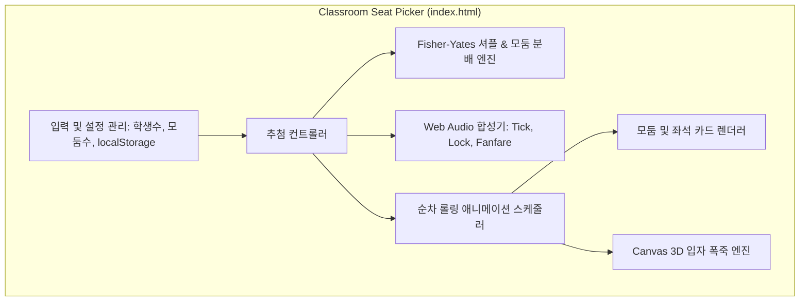

# 우리 반 자리 뽑기 웹앱 구현 계획 (Implementation Plan)

> **For agentic workers:** REQUIRED SUB-SKILL: Use superpowers:subagent-driven-development to implement this plan task-by-task. Steps use checkbox (`- [ ]`) syntax for tracking.

**Goal:** 초·중·고 교실 전자칠판 및 PC에서 외부 의존성/네트워크 없이 단일 HTML 파일로 실행되는 슬롯머신 스타일의 순차 롤링 애니메이션, 효과음, 폭죽 효과를 갖춘 모둠 자리 뽑기 웹앱을 구축한다.

**Architecture:** 단일 `index.html` 파일 내에 모던 시맨틱 HTML, 교실 칠판 테마 반응형 CSS, 그리고 상태 관리·암호학적 Fisher-Yates 셔플 엔진·Web Audio 신시사이저·Canvas 입자 물리 폭죽 엔진을 독립 모듈 형태로 집약하여 네트워크 100% 독립 동작을 보장한다.

**Architecture Diagram:**



**Tech Stack:** HTML5, CSS3 (Modern Flexbox/Grid, Animations), Pure Vanilla JavaScript (ES2020+, Web Audio API, Canvas 2D API)

**Spec:** [docs/superpowers/specs/2026-10-14-random-seat-picker-design.md](file:///c:/Users/bbakj/Downloads/random%20seat/docs/superpowers/specs/2026-10-14-random-seat-picker-design.md)

## Global Constraints
- 단일 자립형 파일 `index.html`로 패키징 (외부 CDN, 외부 mp3, 외부 이미지 의존성 0%).
- 학생 이름은 일절 사용하지 않으며 1번부터 N번까지의 번호로만 좌석을 표시.
- 난수 생성 시 중복 배정 및 누락 없이 1번부터 N번까지 공평 배분.
- 브라우저 더블 클릭만으로 로컬 파일(`file://`) 프로토콜에서도 완벽하게 동작.

---

### Task 1: 셔플 및 모둠 분배 코어 로직 작성 및 단위 테스트

**Files:**
- Create: `tests/core.test.js`
- Create: `src/core.js`

**Interfaces:**
- Produces:
  - `validateInputs(totalStudents, groupCount): { valid: boolean, error?: string }`
  - `distributeGroups(totalStudents, groupCount): Array<{ groupId: number, name: string, count: number }>`
  - `generateShuffledSeats(totalStudents, groupCount): Array<{ groupId: number, name: string, seats: Array<{ seatIndex: number, studentNumber: number }> }>`

- [ ] **Step 1: 실패하는 단위 테스트 작성**

`tests/core.test.js` 파일에 셔플의 중복 없음, 번호 완전성(1..N 포함), 균등 분배(25명/6모둠 -> 5명 1모둠, 4명 5모둠), 입력 유효성 검사 테스트를 작성한다.

```javascript
// tests/core.test.js
const assert = require('assert');
const { validateInputs, distributeGroups, generateShuffledSeats } = require('../src/core');

console.log('Running Task 1 tests...');

// 1. Validation Tests
assert.deepStrictEqual(validateInputs(24, 6), { valid: true });
assert.strictEqual(validateInputs(5, 6).valid, false); // 학생수 < 모둠수
assert.strictEqual(validateInputs(1, 1).valid, false); // 학생수 < 2

// 2. Group Distribution Tests
const dist = distributeGroups(25, 6);
assert.strictEqual(dist.length, 6);
const totalAssigned = dist.reduce((acc, g) => acc + g.count, 0);
assert.strictEqual(totalAssigned, 25);
assert.strictEqual(dist[0].count, 5); // 앞쪽 1개 모둠은 5명
assert.strictEqual(dist[1].count, 4); // 나머지 5개 모둠은 4명

// 3. Shuffled Seats & Number Integrity Tests
const result = generateShuffledSeats(30, 5);
assert.strictEqual(result.length, 5);
const allNumbers = [];
result.forEach(group => {
  assert.strictEqual(group.seats.length, 6);
  group.seats.forEach(s => allNumbers.push(s.studentNumber));
});
assert.strictEqual(allNumbers.length, 30);
const uniqueNumbers = new Set(allNumbers);
assert.strictEqual(uniqueNumbers.size, 30);
for (let i = 1; i <= 30; i++) {
  assert.ok(uniqueNumbers.has(i), `Number ${i} should be present`);
}

console.log('All Task 1 tests passed successfully!');
```

- [ ] **Step 2: 테스트 실행 및 실패 확인**

Run: `node tests/core.test.js`
Expected: FAIL with `Cannot find module '../src/core'`

- [ ] **Step 3: 코어 로직 구현**

`src/core.js`를 작성한다.

```javascript
// src/core.js
function validateInputs(totalStudents, groupCount) {
  const students = parseInt(totalStudents, 10);
  const groups = parseInt(groupCount, 10);

  if (isNaN(students) || isNaN(groups)) {
    return { valid: false, error: '숫자를 올바르게 입력해 주세요.' };
  }
  if (students < 2 || students > 60) {
    return { valid: false, error: '학생 수는 2명 이상 60명 이하이어야 합니다.' };
  }
  if (groups < 1 || groups > 12) {
    return { valid: false, error: '모둠 수는 1개 이상 12개 이하이어야 합니다.' };
  }
  if (students < groups) {
    return { valid: false, error: '학생 수는 모둠 수보다 크거나 같아야 합니다.' };
  }
  return { valid: true };
}

function distributeGroups(totalStudents, groupCount) {
  const base = Math.floor(totalStudents / groupCount);
  const remainder = totalStudents % groupCount;
  const groups = [];

  for (let i = 0; i < groupCount; i++) {
    const count = i < remainder ? base + 1 : base;
    groups.push({
      groupId: i + 1,
      name: `제 ${i + 1} 모둠`,
      count
    });
  }
  return groups;
}

function shuffleArray(array) {
  const arr = [...array];
  for (let i = arr.length - 1; i > 0; i--) {
    let j;
    if (typeof crypto !== 'undefined' && crypto.getRandomValues) {
      const buf = new Uint32Array(1);
      crypto.getRandomValues(buf);
      j = buf[0] % (i + 1);
    } else {
      j = Math.floor(Math.random() * (i + 1));
    }
    [arr[i], arr[j]] = [arr[j], arr[i]];
  }
  return arr;
}

function generateShuffledSeats(totalStudents, groupCount) {
  const groupsInfo = distributeGroups(totalStudents, groupCount);
  const numbers = Array.from({ length: totalStudents }, (_, i) => i + 1);
  const shuffledNumbers = shuffleArray(numbers);

  let numIndex = 0;
  return groupsInfo.map(group => {
    const seats = [];
    for (let s = 0; s < group.count; s++) {
      seats.push({
        seatIndex: s + 1,
        studentNumber: shuffledNumbers[numIndex++]
      });
    }
    return {
      groupId: group.groupId,
      name: group.name,
      seats
    };
  });
}

if (typeof module !== 'undefined' && module.exports) {
  module.exports = { validateInputs, distributeGroups, shuffleArray, generateShuffledSeats };
}
```

- [ ] **Step 4: 테스트 실행 및 통과 확인**

Run: `node tests/core.test.js`
Expected: `All Task 1 tests passed successfully!`

- [ ] **Step 5: Git 커밋**

```bash
git add tests/core.test.js src/core.js
git commit -m "feat: implement and test core shuffling and group distribution logic"
```

---

### Task 2: UI 레이아웃, 교실 칠판 테마 스타일 및 초기 렌더러 구현

**Files:**
- Create: `index.html`

**Interfaces:**
- Consumes: Task 1의 `validateInputs`, `distributeGroups`, `generateShuffledSeats`
- Produces: 완전한 교실 반응형 화면, 상단 설정바, 칠판 기준 바, 모둠 카드 그리드, 초기 좌석 렌더링

- [ ] **Step 1: HTML 및 CSS 기본 골격과 렌더러 작성**

`index.html` 파일에:
- 시맨틱 마크업 (헤더, 설정 폼, 칠판 표시바, 모둠 그리드 컨테이너, 캔버스 오버레이).
- CSS: 반응형 변수, 모던 교실 칠판 그린 테마, 모둠별 파스텔 태그 색상, 고대비 폰트, 애니메이션 키프레임.
- 초기 로드 시 입력값에 따른 기본 모둠 카드 렌더링 (`renderInitialSeats()`).

- [ ] **Step 2: 로컬 브라우저 렌더링 검증**

브라우저에서 `index.html`을 열어 레이아웃, 모둠 그리드 반응형 정렬, 칠판 표시바가 제대로 렌더링되는지 확인.

- [ ] **Step 3: Git 커밋**

```bash
git add index.html
git commit -m "feat: implement classroom blackboard UI layout and initial responsive grid"
```

---

### Task 3: Web Audio 사운드 합성기, Canvas 입자 폭죽 및 순차 롤링 애니메이션 구현

**Files:**
- Modify: `index.html`

**Interfaces:**
- Consumes: `AudioContext`, `HTMLCanvasElement`
- Produces:
  - `SoundController.tick()`, `SoundController.lock()`, `SoundController.fanfare()`, `SoundController.toggleMute()`
  - `ConfettiEngine.fire(durationMs)`
  - `SeatAnimationController.startDraw()` (고속 롤링 -> 1모둠부터 순차 락인 -> 피날레)

- [ ] **Step 1: Web Audio 신시사이저 모듈 구현**

외부 오디오 파일 없이 `OscillatorNode`와 `GainNode`를 사용하여 틱 사운드, 락인 사운드, 팡파레 사운드 구현.

- [ ] **Step 2: 경량 Canvas 입자 폭죽 엔진 구현**

중력, 공기 저항, 3D Y축 회전 입자를 캔버스에 렌더링하는 `ConfettiEngine` 작성.

- [ ] **Step 3: 순차 롤링 애니메이션 스케줄러 구현**

40ms 주기로 전체 카드의 숫자가 무작위로 변경되다가, 1.5초 후 1모둠부터 0.4초 간격으로 각 모둠 좌석이 최종 번호로 확정되며 팝업되는 시퀀스 구현.

- [ ] **Step 4: 애니메이션 및 사운드 인터랙션 동작 검증**

자리 뽑기 시작 버튼 클릭 시 롤링 -> 순차 락인 -> 효과음 -> 폭죽 -> 완료 상태 전환이 매끄럽게 동작하는지 확인.

- [ ] **Step 5: Git 커밋**

```bash
git add index.html
git commit -m "feat: implement Web Audio sound synth, canvas confetti, and sequential rolling animation"
```

---

### Task 4: '다시 뽑기', 설정 자동 저장(LocalStorage), 단축키 및 최종 통합 검증

**Files:**
- Modify: `index.html`
- Create: `tests/e2e-check.js`

**Interfaces:**
- Consumes: 모든 앞선 모듈
- Produces: 재추첨 기능, 전체화면(`F`), 음소거(`M`), 추첨 실행(`Space`/`Enter`), 인쇄 최적화

- [ ] **Step 1: '다시 뽑기' 및 사용자 설정 보존(LocalStorage) 연결**

추첨 완료 시 '다시 뽑기' 버튼 활성화, 학생 수/모둠 수 변경 시 `localStorage` 자동 보존 및 불러오기.

- [ ] **Step 2: 교실 편의 단축키 및 전체화면 지원**

`F` (전체화면), `M` (음소거), `Space`/`Enter` (뽑기 실행) 이벤트 리스너 등록.

- [ ] **Step 3: 단일 파일 자립성 및 무결성 자동 검사 스크립트 작성 및 실행**

`tests/e2e-check.js` 작성하여:
1. `index.html`이 외부 네트워크 URL(`http://`, `https://`)을 참조하지 않는지 확인.
2. 모든 필수 엘리먼트와 자바스크립트 함수가 온전히 포함되어 있는지 검사.

- [ ] **Step 4: 검사 실행 및 통과 확인**

Run: `node tests/e2e-check.js`
Expected: `All single-file E2E checks passed successfully!`

- [ ] **Step 5: Git 커밋**

```bash
git add index.html tests/e2e-check.js
git commit -m "feat: complete redraw controls, localStorage persistence, shortcuts, and e2e verification"
```
